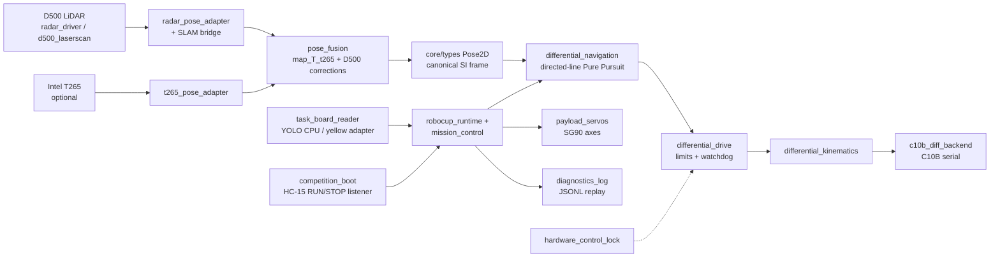
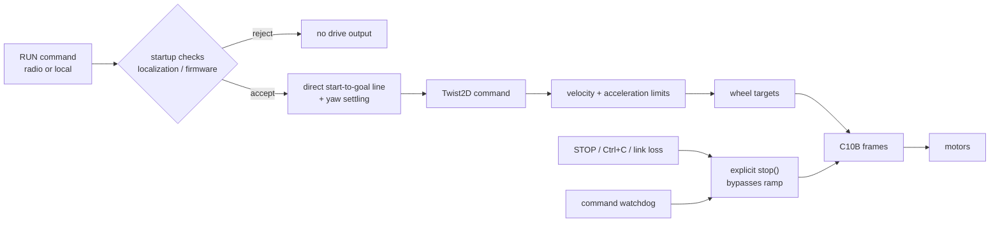

# System Architecture — RoboCup Differential Ground Robot

> **Scope**: architecture of the RoboCup differential-drive stack at `main` =
> `b6ab4df455e0a7f11136314fc11f06c0de3f449b` (2026-10-17). This page adds
> diagrams and a component→evidence map; the authoritative design rationale lives
> in [ARCHITECTURE.md](ARCHITECTURE.md) and is not duplicated here.

## 1. Purpose and boundary

The robot is a **differential-drive** chassis (two driven centre wheels, passive
front/rear supports), not the Ackermann platform of the `car` repository. It runs
RoboCup missions: task-board recognition, wall/route navigation, payload drops and
a dry-run mode that needs no hardware.

The mission runtime is deliberately separated from the board protocol:
`DifferentialNavigation → Twist2D → DifferentialDrive → DifferentialKinematics →
C10B backend`. See [ARCHITECTURE.md](ARCHITECTURE.md) for the layering rules.

## 2. Diagram A — system panorama

## 3. Diagram B — mission execution and safety gate

## 4. Component evidence

| Component | Role | Evidence @ `b6ab4df4` | Status |
|---|---|---|---|
| `code/main_robocup.py` | Formal mission entry; modes and CLI | L19-L26 | production |
| `code/robocup_runtime.py` | Runtime assembly of sensors, navigation, drive and mission | imported by `main_robocup.py` | production |
| `code/components/differential_navigation.py` | **One directed-line Pure Pursuit kernel** plus measured yaw settling; emits `Twist2D` only; the current relative-SLAM path does **not** avoid obstacles | `components/` (module docstring) | production |
| `code/components/differential_drive.py` | Limits, rate limiting, watchdog, safe stop | `components/` | production |
| `code/components/differential_kinematics.py` | `v/omega` ↔ wheel speeds | `components/` | production |
| `code/components/c10b_diff_backend.py` | C10B serial backend, independent watchdog | `components/` | production |
| `code/components/pose_fusion.py` | Fuses T265 odometry with slow D500 corrections | `components/` | production (optional T265) |
| `code/components/radar_pose_adapter.py`, `slam_bridge.py` | D500 pose conversion and SLAM anchor | `components/` | production |
| `code/components/task_board_reader.py`, `yolo_cpu.py`, `yellow_yolo_adapter.py` | Task-board and yellow-target perception | `components/` | production |
| `code/components/payload_servos.py`, `servo_axis.py` | Payload drop servos | `components/` | production |
| `code/components/competition_boot.py` → `code/competition_boot.py` | HC-15 RUN/STOP listener at boot | `code/competition_boot.py` | production |
| `code/components/diagnostics_log.py`, `pose_log_replay.py` | JSONL logging and replay | `components/` | production |
| `code/core/types.py`, `frames.py`, `health.py` | Immutable SI motion types, SE(2), health states | `core/` | production |
| `code/components/hardware_control_lock.py` | Prevents two processes driving the base | `components/` | production |

## 5. Runtime modes

| Mode | Behaviour | Evidence |
|---|---|---|
| `dry-run` | Fake sensors, fake drive backend, synthetic field goal; no hardware | `README.md` |
| `hardware-probe` | Starts sensors only; does not run autonomous navigation | `README.md` |
| `hardware-mission` | Checks localization readiness and rejects unverified differential firmware when that protocol is selected | `README.md` |
| `full-flow test` | Fixed red/blue/green task-board values, skipping recognition | `code/car_full_flow_test.py` |

## 6. Safety-relevant behaviour

- `DifferentialDrive` rate-limits from the previously applied twist using monotonic
  time and stops the backend when no command arrives within `command_timeout_s`.
- `hardware_control_lock.py` ensures a single process owns the physical base.
- `STOP` (radio or local), `Ctrl+C` and process shutdown clear drive output; the old
  total mission timeout was intentionally disabled (README).
- Formal hardware mode is gated on measured geometry/readiness; unmeasured values
  stay configuration, never hard-coded assumptions ([ARCHITECTURE.md](ARCHITECTURE.md)).

## 7. Validation and limitations

- **Dry-run is the only mode verified in software-only environments**; hardware
  modes require a vehicle. See `docs/INTEGRATION_ACCEPTANCE.md`,
  `docs/HARDWARE_MEASUREMENTS.md` and `docs/REFERENCE_AND_LICENSE_NOTES.md`.
- The example geometry and mounts are unverified placeholders; run
  `configs/robocup_diffdrive.example.toml` only as a template.
- No performance or success-rate claims are made here; recorded measurements live
  in the `docs/` test logs, not in this page.
- No root LICENSE; upstream references are documented in
  `docs/REFERENCE_AND_LICENSE_NOTES.md`.
- **Documentation drift**: `docs/ARCHITECTURE.md` still describes an occupancy-grid
  planner with obstacle inflation. At this commit `differential_navigation.py` is a
  directed-line Pure Pursuit kernel (module docstring) and the relative-SLAM path
  does not avoid obstacles. Code is authoritative; the older text should be
  qualified in a follow-up documentation change.
